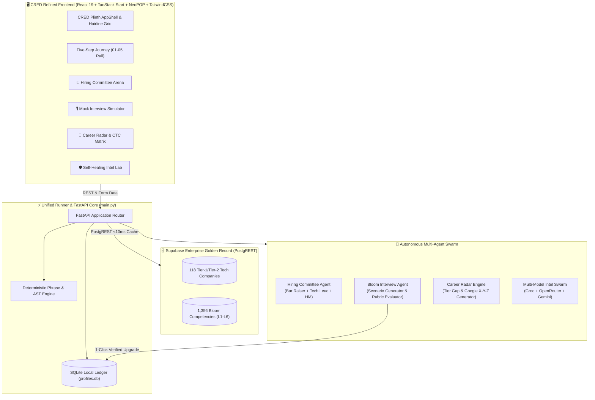

# ⚡ Neural Reapers · RADIX TalentMatch
### *Autonomous Placement Intelligence Hub & Multi-Agent Talent Acceleration Engine*

[](https://python.org)
[](https://fastapi.tiangolo.com)
[](https://react.dev)
[](https://www.typescriptlang.org)
[](https://tanstack.com)
[](https://github.com/CRED-CLUB/neopop-web)
[](https://supabase.com)
[](https://docs.pytest.org)
[](LICENSE)

---

## 🌟 Executive Summary & Vision

Every hackathon submission was provided the same core placement hub specification and session materials. Most teams built a static keyword counter with percentage bars.

**Top tech employers (Google, Meta, Uber, Netflix, Microsoft) do NOT hire with keyword counters.** They evaluate candidates through:
1. **Multi-persona Hiring Committees** that debate architectural rigor, long-term craft, and concurrency tradeoffs.
2. **Deep System Design & Behavioral Rubrics** calibrated across **Bloom's Taxonomy** levels (*Understand* $\rightarrow$ *Apply* $\rightarrow$ *Analyze* $\rightarrow$ *Evaluate* $\rightarrow$ *Create*).
3. **Financial ROI Placement Tiers** that focus a student's finite preparation time on the highest-yield skill delta (+₹12–18 LPA).
4. **World-Class Tactile Aesthetics**: A luxury **CRED NeoPOP "Plinth"** interface with hairline grids, elevated 3D depth, and instantaneous micro-interactions.

**RADIX TalentMatch** is an autonomous, local-first intelligence ecosystem that bridges the gap between college curricula and Tier-1 industry standards. It pairs a **deterministic AST verification engine** with a **live 118-company Supabase Golden Record**, an **agentic LLM swarm** (Groq, OpenRouter, Gemini), and a **CRED-grade UI/UX**.

---

## 🚀 Quickstart

You can run RADIX TalentMatch via the **Unified Production Runner** (FastAPI serves both backend & frontend on a single port) or in **Full-Stack Hot-Reload Dev Mode**:

### Option A: Unified Single-Command Runner (Recommended)
```bash
# Clone the repository
git clone https://github.com/esotericdunce/radix-reapers.git
# Or via SSH: git clone git@github.com:esotericdunce/radix-reapers.git
cd radix-reapers

# Run the unified single-command runner (starts both Web UI on 8080 & API on 8000)
python3 main.py
```
- 🎨 **CRED NeoPOP Web Application:** [http://localhost:8080](http://localhost:8080)
- ⚙️ **FastAPI REST API:** [http://localhost:8000](http://localhost:8000)
- 📖 **Interactive Swagger API Docs:** [http://localhost:8000/docs](http://localhost:8000/docs)

### Option B: Interactive Full-Stack Dev Mode (with Hot Reloading)
```bash
# Terminal 1: Backend
cd radix-talentmatch/backend
source .venv/bin/activate
uvicorn app.main:app --reload --port 8000

# Terminal 2: CRED NeoPOP Frontend (TanStack Start + Vite)
cd radix-talentmatch/frontend
bun install
bun run dev
```
- 🎨 **CRED Refined Frontend:** [http://localhost:8080](http://localhost:8080)
- ⚙️ **Backend REST API:** [http://localhost:8000](http://localhost:8000)

---

## 🏗️ System Architecture



---

## 🏆 The 4 Standout Differentiators (Why We Win)

### 1. 👥 Autonomous Hiring Committee & Deliberative Consensus (`/hiring-committee`)
- **The Problem:** Single match percentages fail in real-world tech hiring. One interviewer's enthusiasm doesn't protect against another's veto.
- **The Solution:** A 3-persona deliberation panel that simulates genuine enterprise debriefs:
  - 🛡️ **Bar Raiser:** Enforces system engineering standards, long-term code maintainability, and clean architecture.
  - ⚡ **Tech Lead:** Rigorously probes concurrency, distributed resilience, scale limits, and SLA tradeoffs.
  - 🎯 **Hiring Manager:** Gauges delivery speed, product intuition, cross-functional communication, and team velocity.
- **Live Output:**
  - Individual votes (`STRONG HIRE`, `LEAN HIRE`, `LEAN NO HIRE`, `NO HIRE`).
  - Formal reservations, documented strengths, and deliberative debate logs.
  - Final consensus verdict (`OFFER`, `LEAN HIRE`, `HIRE WITH CONDITIONS`, `REJECT`).
  - Clear **"Flip the Skeptic"** actionable recommendations.

---

### 2. 🎙️ Adaptive Mock Interview Arena with Bloom's Taxonomy (`/interview-arena`)
- **The Problem:** Resumes and portfolios claim skills that candidates cannot defend verbally or architecturally under pressure.
- **The Solution:** Real-time production interview terminal calibrated directly against company-specific hiring criteria:
  - **Dynamic Scenario Generation:** Prompts grounded in real architectural challenges (e.g., Zomato 100k req/sec flash sale, Google Spanner consensus, Amazon zero-downtime deployment).
  - **4-Dimensional Evaluation Scorecard:**
    1. *System Architecture & Patterns*
    2. *Concurrency & Scale Defense*
    3. *Edge Case Resilience & Failure Modes*
    4. *Tradeoff Articulation & Decision Defense*
  - **Probing Follow-Up Challenges:** Just like a Staff Engineer, the agent challenges the candidate's initial assumptions.
  - **Production Code Snippets:** Shows candidates how a Principal Engineer writes the solution.
  - **⚡ 1-Click Profile Level Upgrade:** If a candidate demonstrates Level 5 (*Evaluate*) or Level 6 (*Create*) depth, a single click directly updates their verified profile in the database and recalculates all company readiness scores instantly!

---

### 3. 🎯 Placement Tier Radar & ROI CTC Accelerator (`/career-radar`)
- **The Problem:** Generic gap analysis tells students to learn dozens of disjoint technologies without financial context.
- **The Solution:** Financial ROI-driven skill roadmapping:
  - **Tier Benchmarking:**
    - 🦄 **Super Dream:** ₹20 – ₹55+ LPA (Google, Microsoft, Uber, Atlassian)
    - ⭐ **Dream:** ₹12 – ₹25 LPA (Razorpay, Swiggy, Cred, Flipkart)
    - 🏢 **Standard:** ₹4.5 – ₹10 LPA (TCS Digital, Infosys Power, Cognizant)
  - **Highest-ROI Skill Jumps:** Identifies the precise single skill upgrade that unlocks the highest CTC jump (e.g., *Distributed Systems AP $\rightarrow$ EV: +₹16 LPA*).
  - **Google X-Y-Z Resume Bullets:** Formatted following Google's hiring standard:
    > *"Accomplished [X], as measured by [Y], by doing [Z]"*
  - **48-Hour Micro-Project Blueprints:** Weekend-buildable GitHub repositories with architectural schemas designed to immediately prove target competencies.

---

### 4. 🛡️ Supabase Golden Record & Self-Healing Intelligence Dossier (`/company-intel`)
- **The Problem:** Repetitive LLM API calls waste tokens, induce rate limits, and introduce non-deterministic hallucinations.
- **The Solution:**
  - **Supabase-First Golden Record:** Pre-loaded with **118 Tier-1 and Tier-2 Tech Companies** and **1,356 verified Bloom skill rows**.
  - **Zero Tokens & Sub-10ms Latency:** Known enterprise companies resolve directly from verified database records with zero external API calls.
  - **Fallback Intelligence Swarm:** For unlisted startups, an autonomous multi-agent swarm synthesizes intelligence across **Groq**, **OpenRouter**, and **Gemini**.
  - **Level-3 AST Quality Gate:** Verifies data integrity, interview round taxonomy, and skill schemas before persisting into the local intelligence cache.

---

## 🎨 CRED NeoPOP "Plinth" Design System

The application features a bespoke **CRED NeoPOP** aesthetic built for engineering elegance:
- **Hairline Grid Architecture**: Subtle dark-mode grid canvas (`#0c0c0f`) with high-contrast borders and elevated monolithic panels.
- **Tactile Elevated 3D Cards**: Dimensional NeoPOP components featuring sharp edge shadows and smooth depression physics.
- **Command Palette (`⌘K` / `Ctrl+K`)**: Instant keyboard-driven navigation across all modules, candidates, and labs.
- **Responsive 01–05 Guided Journey**: Step-by-step placement rail guiding students from parsing job descriptions to final skill matching.

---

## 📊 Complete Module & Labs Suite

### 🛤️ The 01–05 Placement Journey Rail
| Step | Module | Route | Key Capabilities |
| :---: | :--- | :--- | :--- |
| **01** | **Read the role** | `/jd-analytics` | Deterministic phrase AST extraction, category distribution, evidence snippet extraction |
| **02** | **Read the resume** | `/resume-parser` | Multipart PDF/DOCX/TXT ingestion, section boundary parsing, synthetic sample generator |
| **03** | **Shape the profile**| `/profile` | Editable verified skill ledger, 1–10 Bloom ratings, SQLite persistence, custom roles |
| **04** | **Check readiness** | `/talent-check` | Real-time comparison against 118 Supabase company profiles, category breakdown |
| **05** | **Measure the fit** | `/skill-matching` | Multi-candidate side-by-side comparison, CSV export, print-to-PDF, gap analysis |

### 🔬 The Advanced Labs
| Module | Route | Key Capabilities |
| :--- | :--- | :--- |
| **Overview** | `/` | Live candidate readiness matrix, assessment history, radar chart, quick-action rail |
| **Hiring Committee** | `/hiring-committee` | 3-agent deliberative debate (Bar Raiser, Tech Lead, Hiring Manager), consensus vote |
| **Mock Interview Arena** | `/interview-arena` | Live scenario simulation, 4-axis scorecard, follow-ups, 1-click profile upgrade |
| **Career Radar** | `/career-radar` | Super Dream / Dream readiness, highest-ROI skill jumps, Google X-Y-Z bullets |
| **Company Intelligence** | `/company-intel` | Supabase 118-company record resolver + Groq/OpenRouter fallback agent pipeline |

---

## 🛠️ API Reference

| Method | Endpoint | Description |
| :--- | :--- | :--- |
| `GET` | `/api/health` | System health check and active AI provider diagnostics |
| `GET` | `/api/companies` | List all 118 Supabase-verified enterprise tech companies |
| `GET` | `/api/candidates` | Retrieve seeded and persistent candidate profiles |
| `POST` | `/api/talent-check` | Calculate readiness score against Supabase golden record |
| `POST` | `/api/jd/analyze` | Parse job description text or document via AST engine |
| `POST` | `/api/resume/parse` | Extract skills, education, and experience from resume |
| `POST` | `/api/profile` | Create new candidate profile in SQLite database |
| `PUT` | `/api/profile` | Update existing profile and skill levels |
| `POST` | `/api/committee/deliberate` | Trigger 3-agent Hiring Committee deliberation and consensus |
| `POST` | `/api/interview/start` | Generate domain-specific mock interview scenario |
| `POST` | `/api/interview/evaluate` | Evaluate candidate response across 4 production rubrics |
| `GET` | `/api/career/radar` | Calculate placement tier readiness and ROI skill roadmap |
| `POST` | `/api/resume/tailor-bullet` | Generate Google X-Y-Z formula resume bullet |
| `GET` | `/api/intelligence/company/{name}` | Fetch verified company dossier (Supabase-first with LLM fallback) |

---

## 🧪 Testing & Verification

Comprehensive test suites for both backend and frontend:

```bash
# 1. Backend: 44 Passing PyTest Suites (API, Intelligence, Differentiators, Supabase)
cd radix-talentmatch
PYTHONPATH=backend backend/.venv/bin/pytest backend/tests -v

# 2. Frontend: Passing Vitest Suites (Scoring Formulas & TanStack Routing)
cd radix-talentmatch/frontend
bun run test
```

---

## 👥 Presentation Team: Neural Reapers

- **Team Name:** Neural Reapers
- **Core Focus:** Autonomous Placement Intelligence, AST Verification & Multi-Agent Talent Acceleration
- **GitHub Organization:** [@esotericdunce](https://github.com/esotericdunce)

---

## 📄 License

This project is open-source and licensed under the [MIT License](LICENSE).
